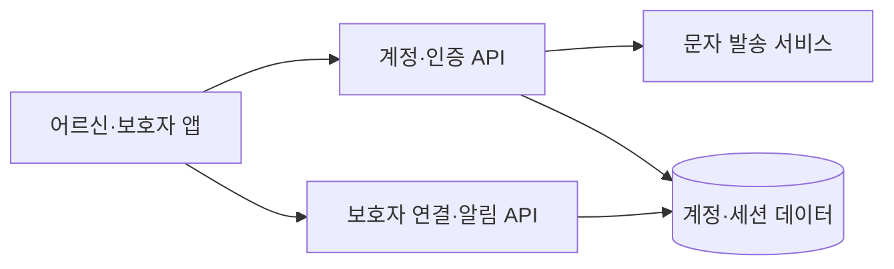

# 어르신 교통 동행 서비스 — 계정·인증 API

멋쟁이사자처럼 연합 해커톤 **용용톤**에서 만든 어르신 교통 동행 서비스의 백엔드 작업을 정리했습니다. 어르신과 보호자가 계정을 사용하고 서로 연결되며, 필요한 알림을 확인할 수 있도록 하는 기능을 담당했습니다.

> 이 저장소는 **김도영의 담당 작업을 설명하는 공개용 포트폴리오**입니다. 팀의 원본 백엔드 저장소는 비공개이며, 팀 코드를 복사하거나 서비스 전체를 혼자 개발한 것처럼 제시하지 않습니다.

## 프로젝트와 내 역할

| 항목 | 내용 |
| --- | --- |
| 프로젝트 | 어르신 교통 동행 서비스 (팀 프로젝트) |
| 담당 | 백엔드 계정·인증, 어르신 정보, 보호자 연결, 알림 조회·읽음 처리 |
| 기술 | Java 21, Spring Boot, MySQL, Flyway, JWT, JUnit, 외부 문자 발송 API |
| 작업 기록 | 팀 저장소의 병합된 PR #3, #7, #9에 해당하는 작업을 아래에 요약했습니다. 원본 PR은 비공개 저장소에 있어 외부에서는 열리지 않습니다. |

## 구현한 기능

1. **계정과 어르신 정보:** 계정·어르신 프로필 및 건강정보 API를 추가하고, 보호자 연결과 동의 관련 기능을 구현했습니다. 계정 데이터의 테이블 관계와 마이그레이션을 정리했습니다.
2. **문자 인증과 로그인:** 전화번호로 인증번호를 요청하고 확인해 로그인하는 흐름을 구현했습니다. 계정 API에 필요한 인증을 적용하면서 팀의 기존 일정·경로 API 접근 방식은 유지했습니다.
3. **로그인 상태 유지:** 접근 토큰 갱신, 기기별 세션, 로그아웃 기능을 추가했습니다. 갱신 토큰은 원문이 아닌 해시로 저장하도록 했습니다.
4. **알림:** 계정 영역에서 알림 목록 조회와 읽음 처리를 구현했습니다. 이동 관련 알림 생성은 다른 팀원 담당이므로 제 구현 범위에 포함하지 않습니다.
5. **실제 문자 발송 연동:** 기존 문자 발송 연동을 센드엠 SMS API로 변경했습니다. 발송 응답을 확인하고 인증 문구 길이를 검사하도록 했으며, 실제 인증 문자를 수신해 로그인까지 점검했습니다.

## 문제를 해결한 과정

| 상황 | 내가 한 일 | 확인 결과 |
| --- | --- | --- |
| 문자 발송 서비스 변경이 필요함 | 발송 API 연동을 변경하고 요청 형식·거절 응답을 테스트함 | 실제 문자 수신 후 인증번호를 이용한 로그인 확인 |
| 팀 브랜치 통합 과정에서 DB 마이그레이션 버전이 겹침 | 충돌한 마이그레이션 번호를 조정함 | 서버 시작 오류를 해결하고 테스트로 확인 |
| 앱을 다시 열 때 로그인 상태를 이어가야 함 | 토큰 갱신과 기기별 세션·로그아웃 흐름을 구현함 | 인증 흐름의 자동화 테스트를 추가함 |

문자 발송 연동 PR 당시 Java 21 환경에서 **전체 테스트 61개가 통과**했고, 무료 테스트 문자 수신과 인증번호를 이용한 로그인까지 확인했습니다. 이 수치는 그 시점의 팀 백엔드 테스트 결과이며, 앱 전체의 최종 배포·운영 성과를 뜻하지 않습니다.

## 기능 흐름

## 공개 범위

팀 저장소의 소스 코드와 PR은 비공개입니다. 이 README에는 제가 맡은 기능, 해결한 문제와 확인한 결과만 정리했습니다. 인증번호, 토큰, API 키, 실제 사용자 정보는 포함하지 않았습니다.
